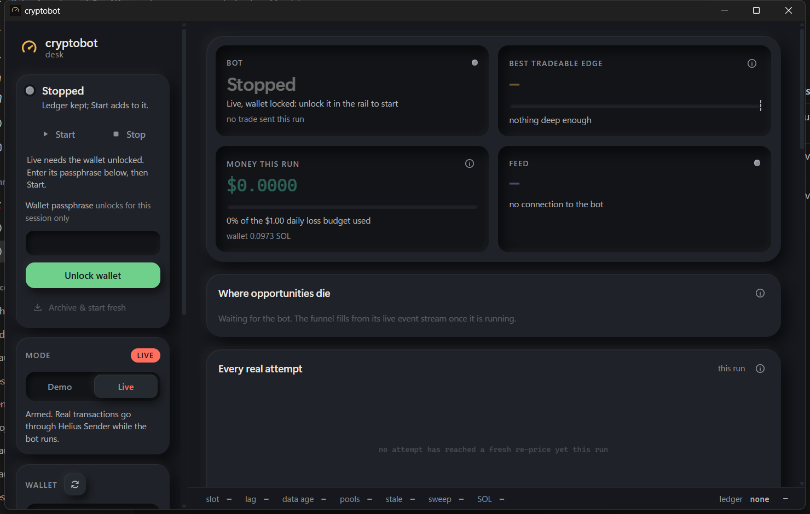
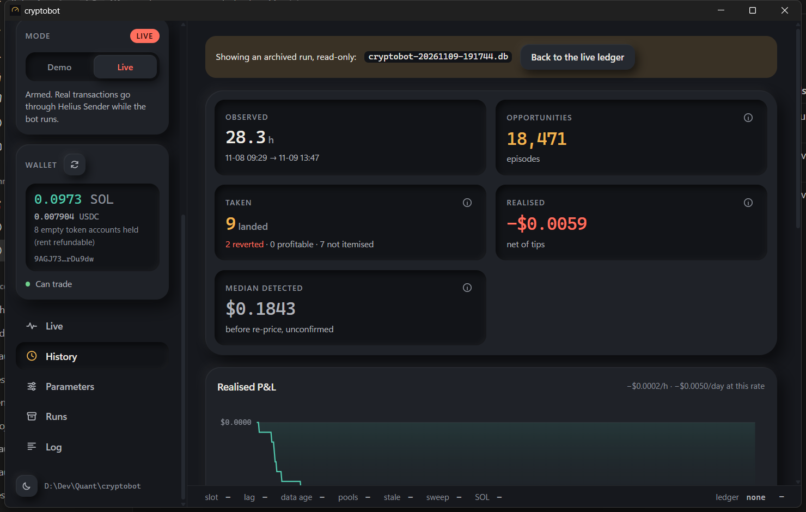
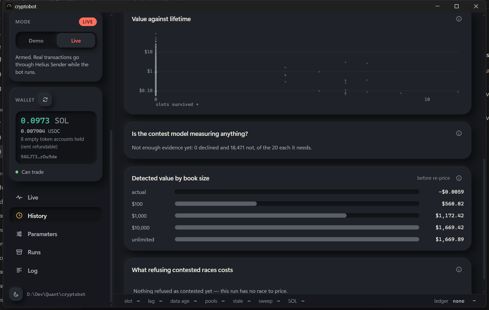
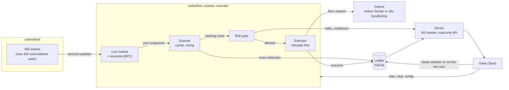
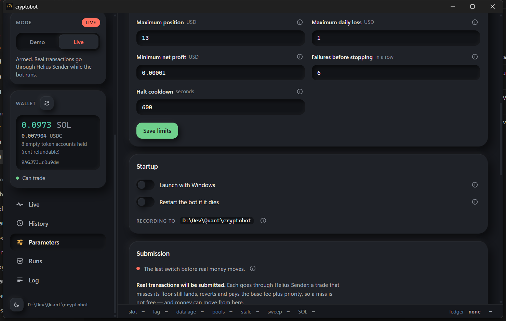
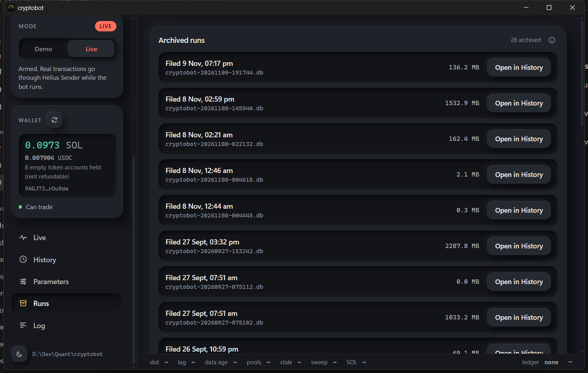

# dislocation_bps

**A measurement instrument for Solana AMM arbitrage, with a live execution path.** It
watches mainnet, prices every 2 and 3 hop cycle it can see, records what *would* have
cleared, and can submit the ones that do.

It exists to answer one question honestly: **is there a tradeable edge from a home PC,
and how big is it?** The answer so far is **no**. The median opportunity is worth
$0.0013, the cheapest round trip costs 2 bps, and a 28 hour live run landed 9 trades,
all of which lost their races to faster bots.

Live execution exists because it was built on request. It is off behind four switches,
and the instrument's own measurements still say not to use it.

[](https://github.com/alenissacsam-2/dislocation_bps/actions/workflows/ci.yml)
[](https://github.com/alenissacsam-2/dislocation_bps/releases/latest)
[](LICENSE)




*Live view with the bot stopped and the wallet locked. Start stays disabled until the
key is unlocked, and the unlock form sits next to it.*

## The answer, so far

### Measured over many runs

| | |
|---|---|
| Cheapest complete round trip anywhere in the universe | **2 bps** |
| Median opportunity, at the size that maximises it, at any capital | **$0.0013** |
| Max lifetime of every opportunity worth more than $0.10 | **0 slots** |

Opportunity size and opportunity lifetime run in **opposite directions**. Sub-cent gaps
loiter for seconds; every one worth more than a dime was gone before the next slot
began. There is no size at which an opportunity is both worth taking *and* still there
when you arrive.

An earlier 15 hour paper run saw 26,131 opportunities, 669 of them clearing, $2.50
realised. Priced at a $10,000 book the same opportunities came to $112, and at unlimited
capital $118: the cycles run out of *depth*, not funding, which is also the measurement
that says a flash loan would have added nothing.

### The 28 hour live run

| | |
|---|---|
| Trades landed | **9** |
| Of those, reverted | **9** (all) |
| Actual cost | **-54,759 lamports**, about **$0.0047** |
| Booked in the ledger | **-$0.0059** (the ledger charges the maximum fee) |
| Lost races | **9 of 9** |

Every landed trade reverted because someone else took the edge first. At least three
competing bots run custom on-chain programs, and one of them sends about 84,000 probes an
hour. A revert is cheap (base fee plus tip), which is why the loss is half a cent, but it
is a loss, and nothing in the run came out ahead.



*History of the archived 28.3 h run: 9 landed, realised -$0.0059. The median detected
value is labelled "before re-price, unconfirmed", because a detection is not a trade.*



*Value against lifetime, the contest model note, and detected value by book size. The
detected values are marked "before re-price".*

### Why it loses: latency

Our round trip from India to Helius Sender is about **280 ms**. Co-located bots run under
**10 ms**. Visible edges are claimed within the block that creates them. See
[`docs/vps.md`](docs/vps.md) for the Singapore and Tokyo option.

### Phantoms that were found and fixed

Long-lived "survivor" edges on PumpSwap and DAMM v2 looked like the best finding the
instrument had produced. They were phantoms: the feed's subscriptions for those pools had
been **refused**, so the pools sat at a stale price while the rest of the market moved.
The feed now shards subscriptions (below) so none are refused. Decoders match on-chain
simulation to within **0 to 0.04 bps** on the venues checked (`cb-check-*`,
`cb-bot --verify`).

### One finding is still open

Edge rises with the fee of the route it is on, 2.16 bps on sub-5 bp routes and 11.95 bps
on routes over 50 bps, and most of the reported value sits on the expensive ones. That
ordering is backwards for real arbitrage: crossing a more expensive pool should leave
*less* behind, not more. A definitional tautology and clock skew were tested and neither
explains a 5x gradient; a later run did not reproduce it. **Until this is explained, treat
any headline profit as unproven.** See §4 of [`HANDOVER.md`](HANDOVER.md), which
catalogues every way this instrument has already been caught lying, including the ones
that passed all their own tests.

### Verdict

**Profit is not expected from a home PC.** The levers left, none proven:

1. **Jito bundleOnly**, which makes failed trades free (see Submission below). The
   2026-11-09 probe landed on chain without a UUID; trades have not been sent this way yet.
2. **Long-tail new pools**, where fewer bots look.
3. **A VPS in Singapore or Tokyo**, to close 280 ms against under 10 ms.

## Install

Download `Cryptobot.Desk_<version>_x64-setup.exe` from the
[latest release](https://github.com/alenissacsam-2/dislocation_bps/releases/latest) and
run it. It installs per-user, so there is no admin prompt, and it carries both the
application and the bot.

**Nothing else is required** — no Rust, no WSL, no Node, no database server. Windows 10
(1809+) or 11, 64-bit, with the WebView2 runtime that ships with both.

An installed copy has no repository to read, so it keeps its config, ledger and archives
in `%LOCALAPPDATA%\cryptobot`, seeding a paper-mode config on first launch. The
Parameters tab prints the exact folder it settled on — a ledger whose location is a guess
is a ledger nobody can go and check.

## Build from source

Requires the Rust toolchain and Visual Studio Build Tools (the C++ workload, for a
linker). `scripts\build.ps1` checks for the latter up front and prints the one-line
`winget` command if it is missing.

```powershell
scripts\build.ps1          # release build of cb-bot and cryptobot-desk
scripts\build.ps1 -Dev     # debug build, faster for UI work
```

Both binaries land in `%LOCALAPPDATA%\cryptobot-win-target\release`. The target
directory is kept off the repository on purpose: a bare `cargo build` writes to
`.\target`, which nothing looks at, and whatever was there before keeps running.

```powershell
& "$env:LOCALAPPDATA\cryptobot-win-target\release\cryptobot-desk.exe" --start
```

To produce the installer:

```powershell
cargo install tauri-cli --version "^2" --locked
scripts\installer.ps1
```

Run from a checkout, the repository *is* the root: the config beside `crates/` is the one
being edited, and the ledger lands where `cb-bot --report` will look for it. Copy
`config.example.toml` to `config.toml` (gitignored) to start.

## The two binaries

**`cryptobot-desk`** is the application. It starts and stops the bot, edits its
parameters, archives runs, and reads the ledger **whether or not anything is running**.
That last part is why it exists: the browser dashboard it replaced was served by the very
process it was observing, so a stopped bot showed no history at all.

**`cb-bot`** is the bot, and runs headless:

```powershell
cb-bot --report        # read the ledger without stopping the run
cb-bot --verify        # audit every decoder against an independent router
cb-verify-encode       # audit every swap encoder against live mainnet
```

The `cb-check-*` binaries (`quote`, `orca`, `cpmm`, `damm`, `pump`) compare a decoder's
quote with an on-chain simulation or an outside router.

> Run `cb-bot` from the repository root. It creates its ledger in the working directory,
> so started elsewhere it quietly opens a second, empty one, which reads exactly like a
> run that found nothing. This has already happened once.

Its API binds **loopback only** (`127.0.0.1:8787`), allow-lists the `Host` header, and has
no authentication.

## How it works

### Crates

```
crates/core       money math: constant-product and concentrated-liquidity quoting,
                  optimal input sizing, marginal edge; config and cycle paths
crates/dex        one pure decode function per venue, no network
crates/feed       websocket account subscriptions, sharded across connections
crates/scanner    pool store, snapshots, cycle enumeration
crates/ledger     SQLite: every sample, every clearing cycle, the queries that
                  collapse detections into opportunities, retention
crates/bot        the event loop, live market and reconcile, venue dispatch,
                  trading loop, --report and --verify
crates/executor   swap encoding, PDA derivation, transaction assembly, simulation,
                  Sender and Jito submission, risk gate
crates/wallet     encrypted key custody: Argon2id, ChaCha20-Poly1305
crates/server     event bus and read-only API, WebSocket stream to the desk
crates/desk       the Windows application (Tauri v2)
```

### Architecture



### One opportunity, start to finish

1. **Account update.** A pool or vault account changes on mainnet. One of the feed's
   WebSocket shards delivers it with its slot.
2. **Live market.** The update is applied only if its slot is newer than what is held for
   that account. A periodic **reconcile** re-reads accounts over RPC but never regresses
   newer feed state. PumpSwap, Raydium v4 and CPMM pools are priced only when their pool
   and vault accounts share a slot, so a torn read cannot produce an optimistic quote.
3. **Scanner.** The decoder in `crates/dex` turns each account into a pool; the scanner
   enumerates 2 and 3 hop cycles and finds the input size that maximises edge.
4. **Ledger.** Every detection is recorded, whether or not anything is sent. Rows are
   de-duplicated: edge is compared to 0.1 bps and the reason with digits blanked.
5. **Risk gate.** Before anything is signed it checks the daily loss, the consecutive
   failure breaker, the cooldown on reverted pools, and the drift guard.
6. **Executor.** The route is re-priced on fresh state, built with output floors, and
   **simulated**. Profit is read from the simulated balance, not from the quote. The
   build refuses any route whose last floor does not exceed its first input.
7. **Submit.** Sent through Helius Sender (default), or as a Jito bundleOnly.
8. **Outcome.** Landed profitable, landed and reverted, or refused (by the gate or by
   simulation). The outcome goes to the ledger and, through the server, to the desk.

**The central mathematical fact**, in `crates/core/src/clmm.rs`: a concentrated-liquidity
pool inside its current tick is *exactly* a constant-product pool over virtual reserves
`x = L/√P`, `y = L·√P`. That identity is why several venues share one quote engine, and
why there is no second implementation to disagree with the first.

Venues decoded include Orca Whirlpool, Raydium CLMM, Raydium CP-Swap, Raydium AMM v4,
Meteora DAMM v2, Meteora DLMM and PumpSwap.

## What it does now

### Submission

| | |
|---|---|
| **Helius Sender** (default) | Every trade is simulated first. The transaction tips a Helius account and bids a priority fee. **A miss still pays fees.** |
| **Jito bundleOnly** | Sent through the Singapore block engine. A once-per-run 1,000 lamport probe is checked on chain. A failed trade costs nothing. On 2026-11-09 the probe landed (slot 467362677) with no UUID, while the block engine's in-flight status said `Invalid` for a full minute: that status is not reliable, so the earlier "all `Invalid`" verdicts may have been wrong too. |

The switch is on the Parameters tab (Submission).



*Parameters: risk limits, startup, and the Submission switch.*

### Risk gate

| Limit | Behaviour |
|---|---|
| Daily loss | Realised losses reaching the limit halt trading; the halt survives midnight. The live run used **$1**; `config.example.toml` ships a different default. |
| Consecutive failures | A run of failures trips the breaker (the live run used **6**). A halt auto-resumes after **600 s**. A lost race that the program reports as "pool could not pay the floor" is not counted as a defect. |
| Reverted pools | After a landed revert, every pool of that route is held out for **20 minutes**. All nine reverts were lost races, and two pools had been retried into the same loss. |
| Drift guard | Refuses a trade when any leg moved more than **50 bps** between detection and re-price, or when that pool moved within the last **5 minutes**. Three of the nine reverts showed this. |

### Wallet and accounts

- Token accounts have a **slot cap**. Excess empty accounts are closed through Sender and
  are not counted as closed until confirmed.
- **Demand-based rotation** replaces the weakest held mint on value alone (1.5x), and
  never closes an account still inside its hold window.
- Each new intermediate mint costs account rent, charged to the balance the profit check
  reads, so the number of distinct mints is a cost, not a free choice.

### Feed and market state

- The feed spreads subscriptions over connections of **at most 400**. One socket of about
  585 had 70 refused, and those pools were silently unwatched (the cause of the phantom
  survivors above). Routing and drop-before-confirm are covered by mock-WebSocket tests.
- Reconcile never regresses newer feed state. It logs per-venue drift and warns once
  about a pool that drifts three passes running with no feed update.
- **PumpSwap fee floor**: the quote charges the dearest fee tier within 10% of market
  cap, because the cap moved from 1381 to 1505 SOL between a read and its simulation.
  The PumpSwap check now agrees within -0.02 bps in both directions.

### Ledger

- Rows are de-duplicated (see above). The previous exact-float comparison made every row
  new and grew the file by about 700k rows an hour, 22 GB in 26 hours.
- Old **unsent** rows are pruned after **3 days**, in batches. Rows that were sent are
  never pruned. New databases use incremental auto-vacuum.

### Desk

- Repaints are batched to **4 Hz**, and the server coalesces pool updates per pool and
  sends them every **250 ms**. Main-thread use fell from 58% to 8% after 30 minutes.
- A **halt banner with a countdown** when the gate trips.
- **Unlock before Start**: with Live selected and the wallet locked, Start is disabled and
  an inline unlock form appears. A crashed bot can be restarted.
- **Truthful labels**: values detected before re-price are marked "before re-price" and
  sit below measured ones. Taken is split into landed, reverted and profitable.



*Archived runs.*

## Building a swap, and checking it against the chain

`crates/executor` encodes swaps per venue and refuses by name rather than guessing when a
venue is not supported. None of it can be verified from a development machine, so there
is a tool that verifies it against mainnet and **needs no key and no funds**:

```powershell
cb-verify-encode                      # account offsets and PDA derivations
cb-verify-encode --as <your address>  # and the instruction itself
```

`--as` takes a **public** address. Simulation runs with signature verification off, so a
placeholder signature is as good as a real one — a diagnostic never needs the wallet it
is diagnosing. When last run over the registry, **154 of 154 vault checks and 53 of 53 readable tick
arrays agreed with live mainnet, with no contradictions.**

Three things it found that reading documentation would not have:

- **A fresh keypair cannot be a fee payer.** The first version signed with a throwaway
  key, reasoning that an empty balance would stop before anything happened. An unfunded
  keypair has no account at all, so the runtime rejected every transaction before
  loading the program — 82 pools reporting `AccountNotFound` with no logs, which looks
  exactly like a broken encoder.
- **The tick array at the current price often does not exist.** An array stores position
  *boundaries*, not the liquidity between them, so a deep pool can have nothing at its
  own tick. Naming three consecutive arrays from the current price — the obvious
  encoding — was wrong for 23 of 48 Raydium pools. The executor now sweeps and asks the
  chain which exist.
- **21 pools hold liquidity and cannot be traded at all**, having no tick arrays
  anywhere. See §4 of [`HANDOVER.md`](HANDOVER.md); one of them is reachable from a base
  mint and has been entering measurements.

What a clean run establishes is the account offsets and the derivations. What it does
not establish is the account *order* inside an instruction, or the arithmetic of a
trade. Only `--as` speaks to the first, and only a funded simulation of a real cycle
speaks to the second.

### Two limits that decide what an arbitrage can be

A transaction is 1232 bytes and every account costs 32 of them. Measured, with real
account sharing between legs:

| cycle | bytes | |
|---|---|---|
| 2 hops | 800 | fits |
| 3 hops | 1048 | fits |
| 4 hops | 1296 | **64 over — two accounts** |

So three hops is the ceiling without an address lookup table, and `assemble` refuses
rather than truncating.

The second limit is the one that makes a signed cycle safe: **the last hop's output
floor must exceed the first hop's input**, and each hop's floor must cover the next
hop's input. Both are enforced in `route::build`, which refuses to encode a route that
violates either. If they hold, a transaction that lands is profitable by construction —
the programs enforce it, and a cycle that goes stale reverts instead of filling. Neither
check depends on this codebase's own arithmetic being right, which is what makes them
worth more than the quote that motivated the trade.

## Safety

Live trading is armed by **three independent things, owned by different parties**:

| | |
|---|---|
| `mode = "live"` in `config.toml` | the app writes it |
| `CRYPTOBOT_ALLOW_LIVE=1` | the environment; the app deliberately does not set it |
| the wallet passphrase, on `cb-bot`'s stdin | only you have it |

Two of the three are not enough. A `cb-bot` started by hand in live mode blocks waiting
for a passphrase, and a live config on its own loads no key.

Past that there is a fourth switch, `dry_run`, which **defaults to true**. While it is
true the bot builds, signs and simulates real transactions and submits none. Arming
execution and spending money are deliberately two decisions.

And past *that*, every trade is simulated against live state before submission, with the
profit read from the resulting balance rather than from the quote, so a wrong instruction
fails in simulation. A transaction that lands is profitable by construction, enforced by
the AMM programs. **The 28 hour run shows the limit of that:** a cycle that goes stale
between simulation and landing reverts, and the revert still costs the fee and the tip.
Safe from a wrong trade is not the same as free.

**What was given up to get here:** until 2026-08-30 `cb-bot` linked no signing code at
all, so no config and no mistake could produce a transaction. That property is gone; the
guarantees above are runtime checks, and the difference between *cannot* and *will not*
is real. See §8 invariant 1 of [`HANDOVER.md`](HANDOVER.md).

A key is encrypted under a passphrase you choose, stored outside the repository's
tracked files, and never committed. RPC errors are redacted so a failing request cannot
print an API key.

### If you do arm it

In this order, and not out of it:

1. **Fund the address.** Every token account a cycle opens costs ~0.00204 SOL in rent,
   permanently locked while it exists, and a three-hop cycle touches three mints. The
   floor is roughly **0.0062 SOL before a single instruction runs**, about 400x the
   transaction fee. The Wallet panel reports the binding constraint by name.
2. **Finish the verification.** `cb-verify-encode --as <your address>` only reaches
   account 3 of 11 while the address holds none of the pools' mints. Once funded it runs
   to completion, and that is the account-order proof.
3. **Set `CRYPTOBOT_ALLOW_LIVE=1`** in the environment `cryptobot-desk` runs in, and
   restart it. The app refuses to arm Live without it.
4. **Unlock the key**, then switch Mode to Live and type `LIVE` to confirm.
5. **Leave `dry_run = true` and watch.** Read the log of what it would have done.
6. Only then consider `dry_run = false`, against an edge the instrument measures as
   negative, with the loss limit set to what you can lose.

Read [`docs/research/04-security.md`](docs/research/04-security.md) before running **any**
third-party Solana bot code, including this.

## Documentation

- [`HANDOVER.md`](HANDOVER.md) — start here. The most useful part is not the
  architecture; it is §4, the catalogue of ways this instrument has already lied, and the
  one way it may be lying now. **Every entry passed all of its own tests.**
- [`docs/research/06-multi-venue-measurement.md`](docs/research/06-multi-venue-measurement.md)
  — the current measurement, and why cross-chain and flash loans do not rescue it.
- [`docs/research/`](docs/research/) — the numbers, the DEX landscape, and the
  infrastructure economics, in the order they were worked out.

## Design principles worth keeping

1. **Refuse rather than extrapolate.** A quote past a tick's capacity, an adaptive-fee
   pool, an unknown fee schedule — decline it. Overstating profit is the only error
   direction that loses money.
2. **A new decoder is not trusted until something outside it agrees.** Errors that
   flatter need an adversary, not more of your own tests.
3. **An opportunity is an episode, not a detection.** One standing gap re-seen five
   hundred times is one opportunity. Summing detections once turned $0.43/hour into
   $105/hour.
4. **Record what the market looked like even when nothing cleared.** A run that records
   only its wins can report the size of a win but never the odds.

## Licence

[MIT](LICENSE).

Nothing here is financial advice, and the headline profit is explicitly unproven. If you
point this at real money you are doing so against the recommendation of its own
measurements.
